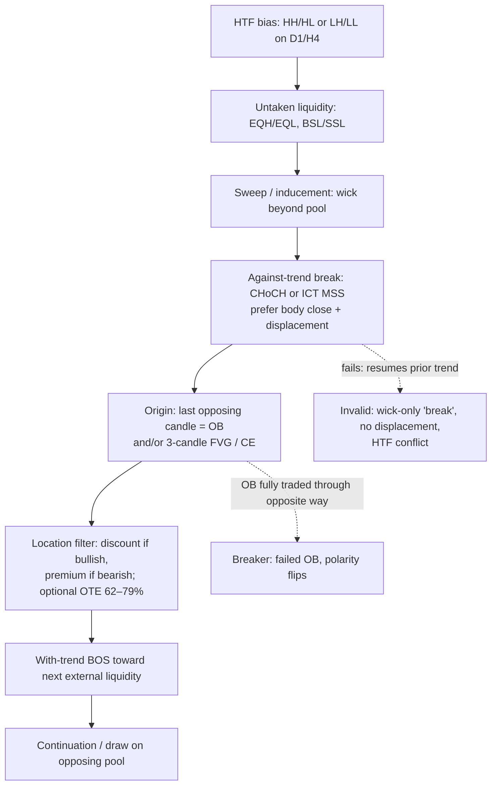

# SMC market STRUCTURE — building blocks only
**Research vocabulary. NOT a tradable system. NOT an edge. No signals, no EA, no orders.**

Written 2026-10-27 (Asia/Bangkok). Sources are listed in §E; every definition below is grounded in those pages or in prior fx-research / archive notes that are cited as **failed candidates**, not as proof of edge.

**ICT vs retail SMC.** Michael Huddleston’s ICT lectures use *market structure*, *market structure shift (MSS)*, *short-/intermediate-/long-term swings*, and *displacement*. Labels **BOS** and **CHoCH** are mainly **retail SMC** words for with-trend vs against-trend breaks. ICT’s **MSS** adds conditions (stop run first + displacement). Do not treat the labels as interchangeable without stating which rule set you are using.

---

## A) Structure map (how pieces nest in sequence)

Canonical *narrative* sequence used across the cited SMC explainers (schematic — not a backtested rule):



ASCII (same chain):

```
HTF structure (bias)
        |
        v
Untaken liquidity (EQH/EQL, session/day extremes)
        |
        v
Sweep / inducement (stops taken; often wick through, close back)
        |
        v
Against-trend break (CHoCH / MSS) with displacement
        |
        v
Origin zone: Order Block and/or FVG (watch CE = 50%)
        |
        v
Location: discount (buy) / premium (sell); optional OTE 62–79%
        |
        v
With-trend BOS toward next external liquidity
```

**Nesting rule:** HTF structure subordinates LTF swings. A M15 CHoCH inside a clear H4 uptrend is often only an internal pullback, not a new HTF trend.

---

## B) Strict definitions + invalidation

### 1) Swing structure

| Term | Definition (operational) | Invalidation / caveat |
|---|---|---|
| **Swing high / low** | Common ICT teach: 3-candle fractal — middle candle has highest high (or lowest low); **confirmed only when the candle after the middle closes**. | Marking the live candle’s extreme before confirmation. |
| **Short-term swing** | That 3-candle swing (ICT). | — |
| **Intermediate-term** | Short-term high with lower short-term highs on both sides (or ICT’s “rebalance” high); bigger than short-term. | Breaking it is ICT’s larger “break in market structure” (2022), not a tiny MSS. |
| **Long-term** | Intermediate high with lower intermediates on both sides; usually daily/HTF. | — |
| **HH / HL** | Uptrend: successive higher highs and higher lows. | Sequence broken when last HL is closed through (bearish shift). |
| **LH / LL** | Downtrend: successive lower highs and lower lows. | Sequence broken when last LH is closed through (bullish shift). |
| **Internal vs external** | **Internal:** swings *inside* the current dealing range (pullback liquidity). **External:** range extremes / opposing side liquidity the move is drawn toward. | Confusing an internal BOS with a new HTF trend. |
| **Swing vs short-term** | In ICT ranking, “short-term” *is* the fractal swing used for MSS; “swing” alone is ambiguous — always state the fractal size (e.g. 1-1 vs 2-2). | Tools that use 5-candle (2-2) swings confirm later and mark fewer points. |

### 2) BOS vs CHoCH (and ICT MSS)

| Term | Definition | What must break | Confirmation vs weak |
|---|---|---|---|
| **Bullish BOS** | With-trend break in an uptrend: close beyond prior **confirmed swing high**. | Prior HH (protected if the HL that made it still holds). | Body close + displacement = strong; wick poke = weak / often just a sweep. |
| **Bearish BOS** | With-trend break in a downtrend: close beyond prior **confirmed swing low**. | Prior LL. | Same. |
| **Bearish CHoCH** | Against-trend break in an uptrend: close beyond last **confirmed HL**. | Last HL. | Early warning only; often needs later bearish BOS (new LL) to “stand up.” |
| **Bullish CHoCH** | Against-trend break in a downtrend: close beyond last **confirmed LH**. | Last LH. | Same. |
| **ICT MSS** | Forceful break of last **short-term** swing *against* trend **after** a run on stops beyond an old high/low, preferably with displacement / FVG. | Short-term swing that formed before the stop run. | Wick through stop level can be the *run*; shift itself prefers a close through the short-term swing. |

**Invalidation of a shift thesis:** immediate reclaim and new extreme in the old direction; HTF structure unchanged; break without displacement (slow grind).

### 3) Liquidity

| Term | Definition | Invalidation / caveat |
|---|---|---|
| **Buy-side liquidity (BSL)** | Inferred resting buy-stops / shorts’ stops **above** highs / equal highs. | Not visible on a retail book; geometry only. |
| **Sell-side liquidity (SSL)** | Inferred sell-stops / longs’ stops **below** lows / equal lows. | Same. |
| **Equal highs / lows (EQH/EQL)** | Near-matching swing extremes that concentrate stops. | “Relative equal” = slightly stair-stepped equals also count in ICT notes. |
| **Inducement** | A lesser liquidity grab that pulls traders in *before* the real POI / deeper pool is taken. | Labeling every small wick as inducement after the fact. |
| **Sweep / stop run** | Price trades through the pool then reverses (often wick through, close back inside). | Same print as a breakout until the close/reversal is known — **hindsight risk**. |

### 4) Order blocks (OB) and breakers

| Term | Definition | Valid vs mitigated |
|---|---|---|
| **Bullish OB** | Last **down** (bearish) candle before a bullish **displacement**. | Valid while price has not closed fully through it against the thesis; stronger if after a sweep, leaves FVG, sits in discount, aligned with HTF. |
| **Bearish OB** | Last **up** candle before bearish displacement. | Mirror. |
| **Mitigated OB** | Price has traded back through the OB range enough that the “unfilled” thesis is spent (convention varies: touch vs full close through). | Do not treat a fully mitigated OB as fresh demand/supply. |
| **Breaker block** | A **failed** OB: structure breaks through it, then price later retests it from the other side (polarity flip). | Without an intervening structure break, some authors call the revisit a “mitigation block” instead. |

### 5) Fair value gap (FVG) / imbalance

| Term | Definition | Fill vs magnet |
|---|---|---|
| **Bullish FVG** | 3 candles where **high of candle 1 < low of candle 3** (gap in between). | May be left open (magnet / unfinished business) or partially/fully filled on a retrace. |
| **Bearish FVG** | **Low of candle 1 > high of candle 3**. | Same. |
| **CE (consequent encroachment)** | **50%** midpoint of the FVG (or of a PD array). | Used as a refinement; full fill not required in ICT-style notes. |
| **IFVG (inverse FVG)** | An FVG that fails and is then traded as support/resistance the other way (2024 ICT lecture notes). | — |

**Invalidation:** treating every tiny 3-candle gap as institutional; ignoring that many FVGs never fill and fills do not guarantee continuation.

### 6) Premium / discount / OTE

| Term | Definition | Invalidation |
|---|---|---|
| **Dealing range** | Swing low→high (bullish context) or high→low (bearish) that brackets the move you care about. | Anchoring on a random minor swing makes the midpoint meaningless. |
| **Equilibrium** | 50% of the dealing range. | — |
| **Premium** | Above ~50% (some guides use >55% with a dead zone). “Expensive” → prefer sells if bearish. | Buying in premium in an uptrend is the classic retail mistake these guides warn about. |
| **Discount** | Below ~50% (or <45%). “Cheap” → prefer buys if bullish. | — |
| **OTE** | Fibonacci **62%–79%** retracement of the impulse leg (often 70.5% as midpoint of that band), used only **with** structure (after BOS/MSS), not alone. | Body close beyond the range origin (100%) typically kills the OTE thesis. |

### 7) Displacement + continuation vs reversal

| Term | Definition | Invalidation |
|---|---|---|
| **Displacement** | Energetic, one-sided move (ICT: “elephant in a children’s pool”); usually leaves an FVG. | Lethargic grind through a level. |
| **Continuation after grab** | Sweep of internal liquidity → displacement with trend → BOS toward external liquidity. | — |
| **Reversal after grab** | Sweep of external liquidity → MSS/CHoCH against prior trend → new OB/FVG → move to opposing pool. | Sweep without displacement/shift is just noise or a failed breakout. |

### 8) Multi-timeframe (conceptual)

| Layer | Role |
|---|---|
| **HTF (e.g. D1 / H4)** | Bias and major liquidity / dealing range. |
| **Mid (H1)** | Working structure, premium/discount of the active range. |
| **LTF (M15 / M5)** | Refine sweep, displacement, FVG/OB entry *location* — subordinate to HTF. |

**Conflict rule (from cited guides):** HTF wins on direction; premium/discount wins on timing. A perfect LTF long against clear HTF bearish delivery is usually a stand-aside.

---

## C) What is often mislabeled or overfitted (honest limits)

1. **BOS / CHoCH / MSS used as three different “signals”** — they are labels for *what broke*; authors disagree on whether CHoCH ≡ MSS.
2. **Wick = structure break** — ICT and careful SMC guides prefer a **close** for the shift; the wick is often the liquidity run *before* the shift.
3. **Unconfirmed swings** — marking the current bar’s high/low as structure before the confirming close.
4. **Every down candle is an OB** — without displacement, sweep context, and location, it is just a candle.
5. **Liquidity is observed** — on retail FX/CFD charts it is **inferred**; there is no consolidated book.
6. **Sweep vs breakout** — identical until later candles close; real-time labeling is easy to overfit in hindsight.
7. **OTE / CE precision** — 70.5% and CE are conventions; cited academic-style evidence that they beat chance is not in the public materials reviewed here.
8. **Indicator packs that paint dozens of OBs/FVGs** — explode degrees of freedom; any “edge” must survive pre-registered, costed tests.
9. **This project’s prior CHoCH candidate (failed, not an edge):** `/workspace/fx-research/NOTES.md` and `/workspace/choch-research` (code-team T19/T20, 2026-10-05). XAUUSD M5 Dukascopy BID, fractal 3/3, CHoCH = close beyond last confirmed swing against structure, limit at 62% retrace, SL origin ±$0.20, TP 2R. At spread 6–25 pts: first 70% of sample **negative** (~−0.05 to −0.10 R/trade); last 30% near breakeven; ~5.5 events/day; median R = −1. **Not validated; not an edge.**
10. **Archive “Kaze” / TradingSystem_v5** — Kaze was M5/M1 EMA pullback alerts (Yahoo GC=F), not pure SMC structure. Drive `TradingSystem_v5` (breaker/OB/engulfing) showed **bogus** backtest metrics (e.g. equity ~1e244) and was closed as document-only. Do not treat archive SMC-flavoured EAs as evidence.

---

## D) Optional XAUUSD note (no new live claim)

No new LOOKAHEAD chart is drawn here. The only XAUUSD structure experiment already on this box with locked rules and honest fills is the **CHoCH study in §C.9** (Dukascopy BID M5, not IC MT5). Source label: **Dukascopy**, not IC. Result: **failed / no edge under the tested costs**. IC mid/bid prices differ slightly from Dukascopy; any future structure test must state feed, session day, and costs up front.

---

## E) Sources actually read (accessed 2026-10-27)

Primary / ICT-leaning public explainers (fetched or searched this session):

1. Quarter Sequence — *ICT Market Structure: Swing Points, BOS and MSS Explained* — https://quartersequence.com/the-study/ict-market-structure/ (quotes ICT 2020–2022 YouTube mentorship timestamps).
2. The Inner Circle Traders — *BOS vs CHoCH* — https://www.theinnercircletraders.com/understanding-break-of-structure-and-change-of-character/ (updated July 2026).
3. The Inner Circle Traders — *ICT Market Structure* / glossary pages (search hits; BOS/CHoCH/BSL/SSL/premium-discount glossary).
4. Liquidity Sweep Trading — *Market Structure, Premium and Discount Zones Explained* — https://liquiditysweeptrading.com/learn/market-structure-premium-discount/.
5. FX Recap — *Smart Money Concepts (SMC) Trading Strategy* — https://fxrecap.com/learn-forex/education/smart-money-concepts.
6. innercircletrader.net tutorial notes — *ICT Consequent Encroachment*; *ICT 2024 Mentorship Lecture 2 & 4* key-element lists (breaker = failed OB; CE = 50% of PD array; FVG 3-candle; liquidity sweep) — https://innercircletrader.net/tutorials/ict-consequent-encroachment/ and related lecture pages.
7. ICT Killzone — *ICT OTE — The 62–79% Optimal Trade Entry Zone* — https://www.ictkillzone.com/ict-ote.
8. DT Terminal Academy — *ICT OTE, Premium and Discount Dealing Ranges* — https://www.thedtterminal.com/academy/ict-dealing-ranges-and-ote.
9. GitHub `SrsBlack/ict-knowledge-library` GLOSSARY.md (corpus note: BOS/CHoCH are SMC labels with 0 hits in some ICT transcript corpora) — https://github.com/SrsBlack/ict-knowledge-library/blob/master/GLOSSARY.md.
10. Project notes (not public ICT): `/workspace/fx-research/NOTES.md` (CHoCH T19/T20 results); `/workspace/bot-archive-20261011/` INDEX + forex-xauusd agent log (Kaze / v5 caveats).

**Discarded / not relied on:** random indicator-marketing blogs that only restate buzzwords without definitions; the bogus TradingSystem_v5 equity curve.

**Source count for the milestone:** **10** listed above (8 external web + 2 local project/archive).

---

## Bottom line for dr eggbot

SMC structure is a **shared chart language** (swings → liquidity → shift → OB/FVG → premium/discount). It does **not**, by itself, constitute a tested edge on this desk. Prior CHoCH automation on XAU M5 failed under costs. Any future test must pre-register swing size, close-vs-wick rule, costs, and holdout — and must not confuse LOOKAHEAD labeling of sweeps with a live rule.
